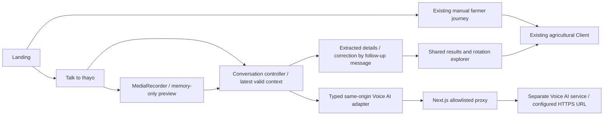

# Voice integration: Milestone A

## Audit and implementation plan

Existing Next.js 16 App Router, client-side farmer state machine, TanStack Query and agricultural Client remain in place. Results already include rotation discovery, scientific notices, evidence, print/download recovery and deferred secondary views. The manual journey is not replaced.

Source: backend team Voice Extraction API Frontend Guide (three pages). Its placeholder host/port is historical, never a configuration default. The replacement directive defines a separate service. No production service URL or authentication contract has been supplied; live voice integration cannot be verified yet.

Plan: (1) typed contract and runtime validation; (2) bounded, cancellable proxy and client; (3) explicit conversation state and resource-safe recorder; (4) review/correction/results reuse; (5) two clear entry options and unavailable-service guard; (6) isolated mock tests, manual regression, build/lint/types and responsive review. No production mock adapter or generated advice fallback.

## Boundaries and provisional contract

Voice upstream: GET /health, POST /extract/text (JSON message/context), POST /extract/voice (multipart audio/context and optional state/lga). Follow-up context is the entire last valid response, including unknown keys, not a hand-picked subset. Corrections are new farmer-authored messages with that context; no frontend-only edits are presented as successful.

Private VOICE_AI_BASE_URL supplies the entire voice-service base including any deployment prefix. VOICE_AI_ENABLED must remain false until Milestone B. No fallback to the agricultural URL, no localhost/default ports and no assumed auth header. Only configured HTTPS upstreams are accepted. Existing NEXT_PUBLIC_API_BASE_URL remains agricultural only.

Same-origin proxy chosen for controlled forwarding, private configuration and avoiding dependence on unverified CORS. Public POSTs require a matching Origin; request paths and forwarded fields are allowlisted. No raw upstream errors, conversation/audio logs, credentials, cookies or arbitrary request headers are forwarded. Platform/body-size errors must remain recoverable.

Vercel documents a 4.5 MB function request limit: https://vercel.com/docs/functions/limitations . The guide permits 25 MB audio upstream, but this frontend conservatively caps recordings at 3.5 MB, with context/envelope bounds below the platform limit. The UI discloses this cap. Full 25 MB browser uploads require a verified direct/presigned design, not a false promise that the proxy supports them. MIME mappings are provisional to the guide's mp3/m4a/wav/webm/ogg list; verify deployed media types in Milestone B.

Results use the existing agricultural service for evidence/charts/scenarios/downloads with the returned IDs. Voice results never silently regenerate via the manual agricultural POST. If an ID expires, the farmer returns to the conversation; no missing irrigation/tenure values are fabricated. Incompatible advice pages remain in context and offer a safe text-report fallback rather than unsafe casts.

Manual fallback keeps the conversation controller mounted in memory while the independent manual form is shown; no automatic context-to-form transformation. Leaving/reloading the voice page clears its conversation. Manual-session persistence does not receive voice context, transcript or audio.

## Release gate

Milestone A is implementation and mock verification only. Production voice stays explicitly unavailable while URL/release gate is absent. Milestone B requires the real URL, route/OpenAPI and MIME/schema checks, auth confirmation, actual text/audio multi-turn tests, corrections, main-API advice-ID compatibility, failure handling, device testing, then enabling and deployment. Do not call Milestone A live integration or production voice readiness.

## Implemented files and behaviour

- `src/lib/voice/contract.ts`: runtime response validation, full context retention, strict compatibility gate for existing scientific reports, audio/context limits.
- `src/lib/voice/client.ts` and `proxy.ts`, `src/app/api/voice/[action]/route.ts`: injectable HTTP adapter and allowlisted same-origin proxy; health, text, multipart audio, bounded requests/responses, cancellation, deadlines, safe errors and no automatic POST retries.
- `src/lib/voice/useConversation.ts`: explicit conversational transitions, stale-response protection, correction by follow-up message, review before results, retry and reset.
- `src/lib/voice/useRecorder.ts`: explicit microphone permission, supported MIME detection, timer, stop/preview/delete/re-record, interruption handling, track/object-URL cleanup. Audio remains in memory only; no automatic recording or submission.
- `src/components/VoiceExperience.tsx`, `src/app/talk/page.tsx`, `src/app/voice-experience.css`: accessible voice/text experience, extracted-detail review, supplied text-report fallback, unavailable service and independent manual fallback.
- Existing `Welcome`, `Ihayo`, root page, copy and layout: two entry points, release gate and isolated manual state. Existing `Results`, `Weather` and agricultural API client: compatible result reuse, unique anchors, unavailable secondary actions without an advice ID, explicit expiry recovery without fabricating a manual advice request.
- `.env.example`: private voice URL and disabled release flag. No dependencies or deployment-output settings changed.
- New `tests/voice.test.tsx`, `voice-recorder.test.tsx`, `voice-proxy.test.ts`; existing test setup supports node proxy tests and location regression assertions use the new manual entry label.

## Verification and limitations

Final checks on 15 November 2026: `npm run typecheck` passed; `npm run lint` passed; `npm test -- --maxWorkers=1` passed all **103 tests across 13 files** (34 new voice tests, 69 existing tests); `npm run build` passed; `git diff --check` passed. The last two additions test device-pause microphone cleanup and context preservation across the independent manual fallback. No tests used the pending live Voice AI service.

Production build succeeded under Next.js 16.4.6, including `/talk` and dynamic `/api/voice/[action]`. `.next/routes-manifest.json` exists; standard Next.js/Vercel configuration remains intact. TypeScript and ESLint passed. Automated tests use mock voice transports and simulated MediaRecorder, never a live voice service. The existing accessibility tests emit jsdom's known unimplemented canvas warning; they pass but do not establish real-browser colour contrast compliance.

Local production browser checks: `/talk` displays unavailable status, hides recording controls, offers retry and opens the existing manual location form. That form loaded live agricultural state data; returning to the conversation works. Both homepage entry points are visible. Checked 360, 390, 768 and 1440px viewports without horizontal overflow on the voice unavailable page. Desktop, tablet, mobile and manual-fallback screenshots are stored outside the repository in `../outputs/voice-integration/`. These are Chromium viewport checks, not physical Android/iOS tests or enabled-service visual QA.

Local GET `/api/voice/health` returned HTTP 503 with `not_configured` as intended. This proves the disabled gate, not upstream health. Actual voice health, authentication, MIME support, speech recognition, context/correction behaviour, rate limits, report schema and agricultural advice-ID compatibility remain unverified. Real microphone/audio, mobile Safari/Android, slow live-service and failure tests belong to Milestone B. No multilingual/Pidgin or speech playback support is claimed. Shared scientific warnings remain unchanged.

No commit, push, production enablement or Vercel deployment is performed in Milestone A. The directive schedules these after live verification in Milestone B.

## Backend handoff / deployment configuration

Keep existing agricultural environment variables unchanged. Set private `VOICE_AI_BASE_URL` only when the team supplies the real HTTPS base URL (include any documented prefix). Keep `VOICE_AI_ENABLED=false` until live verification passes; then enable deliberately in the intended deployment environment and rebuild, because the homepage release badge is prerendered. No credentials are currently assumed or forwarded; implement only the authentication contract actually supplied by the team.

Before release: verify GET `/health`, POST `/extract/text`, POST `/extract/voice`; actual request/response schemas and MIME types; full-response context and corrections; real recording on target devices; report completeness and scientific notices; evidence/scenarios/charts/download ID compatibility; expired advice recovery; timeout/cancel/429/retry behaviour; upload limits and platform duration; public abuse/rate-limit controls. If 25 MB audio is required, resolve the Vercel proxy limit with a verified architecture before promising that capacity. Run regression checks, enable, commit/push without force, and verify the public Vercel URL.
